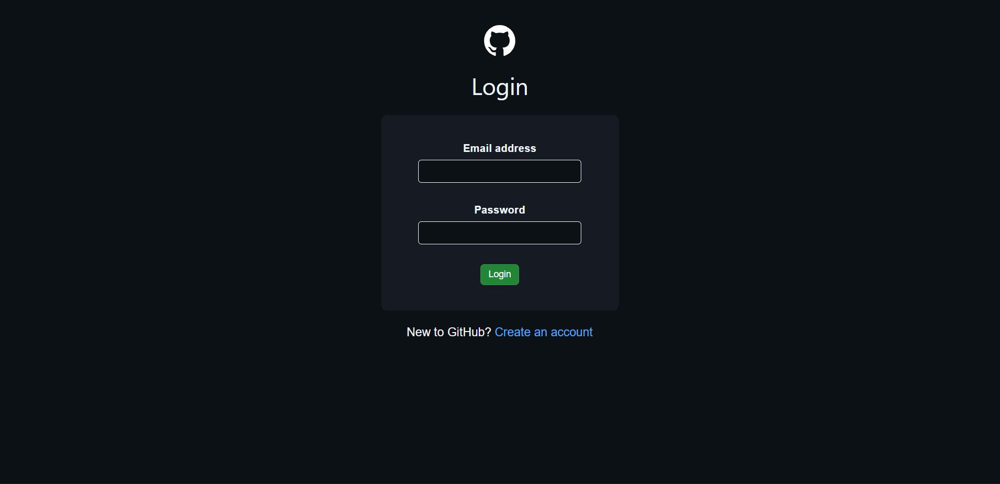
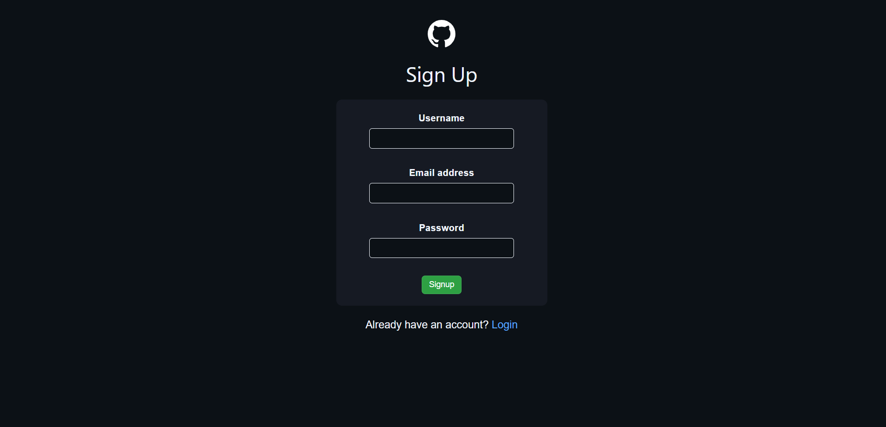
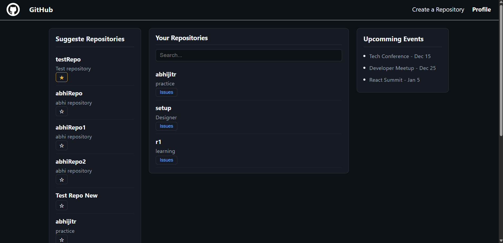
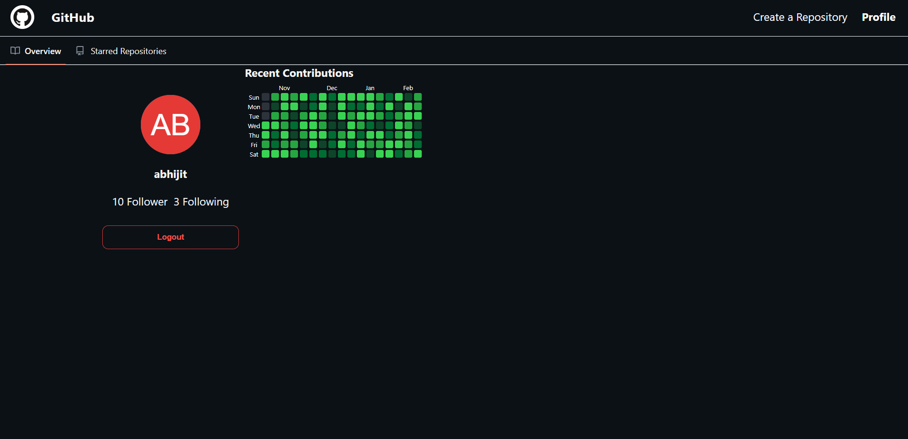
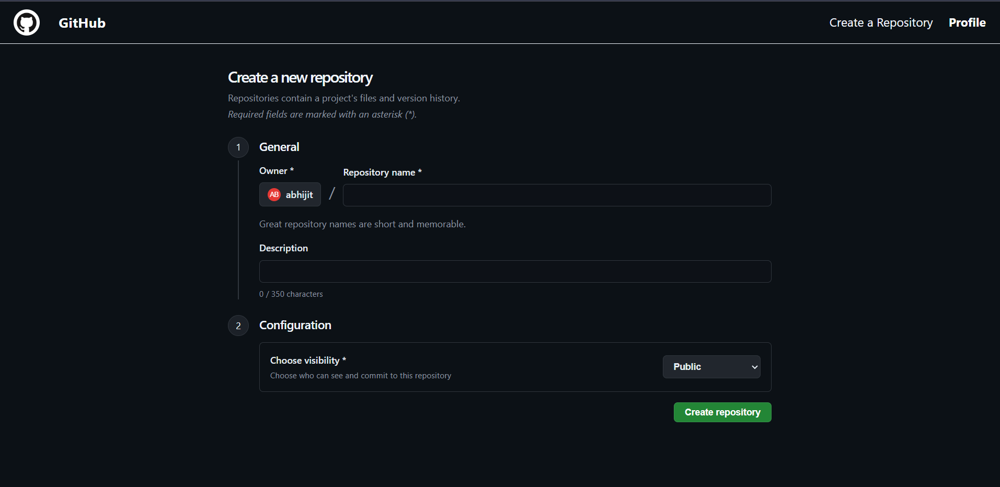
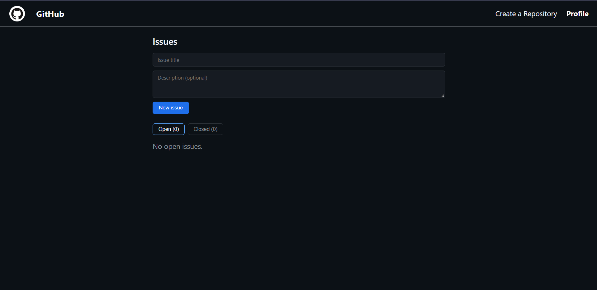
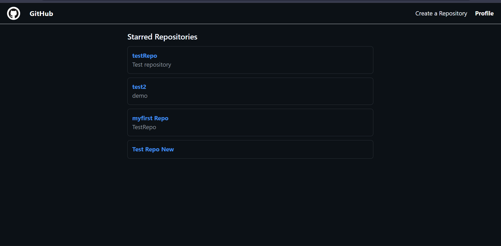
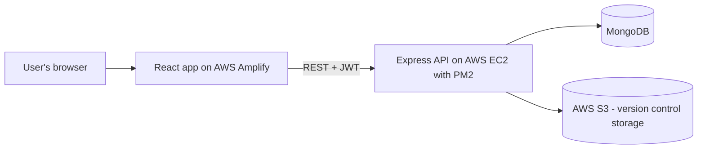

<div align="center">

# 🐙 GitHub Clone — Frontend

**A GitHub-inspired platform where you can create repositories, track issues, star projects and explore your profile — backed by its own mini version-control system.**

[🚀 Live Demo](https://main.d1jwxcdr5bwis6.amplifyapp.com/) · [🎥 Demo Video](https://youtu.be/K1VGrIL52ZQ) · [⚙️ Backend Repo](https://github.com/abhi7044/github-backend-demo)


</div>

> ⚠️ **Heads-up:** the backend runs on a small AWS EC2 server. If sign-up or login does not respond, the server may be switched off to save cost — please watch the demo video instead.

> ⚠️ **Note:** If login does not work, the server may be offline. Please watch the demo video.
---

## 📸 Screenshots

| Login | Dashboard | Profile |
|---|---|---|
|  |  |  |  |

| Create repo | Issues | Starred |
|---|---|---|
|  |  |  |

---

## ✨ Features

- 🔐 **Sign up and log in** with JWT authentication and protected routes
- 🏠 **Dashboard** with your repositories, suggested repositories and instant search
- ⭐ **Star repositories** and see them on a dedicated *Starred* page
- 🐞 **Issues page** for every repository
- ➕ **Create a repository** from the UI
- 👤 **Profile page** with a GitHub-style contribution heat map

---

## 🧱 Tech Stack

| Area | Tools |
|---|---|
| UI | React 18, React Router, Axios, CSS |
| Build | Vite |
| Data viz | `@uiw/react-heat-map` |
| Hosting | AWS Amplify (auto-deploys on every `git push`) |
| API | Express + MongoDB (see the [backend repo](https://github.com/abhi7044/github-backend-demo)) |

---

## 🗺️ How it fits together



---

## 📁 Project structure

```
src/
├── components/
│   ├── auth/        Login, Signup
│   ├── dashboard/   Dashboard (search, suggested repos, stars)
│   ├── issue/       IssuePage
│   ├── repo/        CreateRepo
│   ├── user/        Profile, HeatMap, StarredRepos
│   └── Navbar.jsx
├── authContext.jsx  Global login state
├── Routes.jsx       Route table + route protection
└── main.jsx
```

---

## 🚀 Run it locally

```bash
# 1. Install packages
npm install

# 2. Point the app to your backend
echo "VITE_API_URL=http://localhost:3000" > .env.local

# 3. Start the dev server
npm run dev
```

Open http://localhost:5173 (start the backend first).

---

## 🧠 Challenges I solved

- **Mixed content & CORS:** an HTTPS frontend cannot call an HTTP backend, so I learned how browsers enforce this and how to expose the API correctly.
- **Environment-based config:** moved the API address into `VITE_API_URL` so the same code runs locally and in production.
- **Auth flow:** kept the user logged in across refreshes and redirected unauthenticated users with route guards.
- **Deployment:** set up CI/CD with Amplify and learned to debug builds from logs.

## 🔮 Roadmap

- Edit / delete repositories from the UI
- Real contribution data for the heat map
- Pull requests and comments on issues

---

<div align="center">

Built by **Abhijeet Mishra** · [GitHub](https://github.com/abhi7044) · [LinkedIn](PASTE_LINKEDIN_LINK_HERE)

</div>
